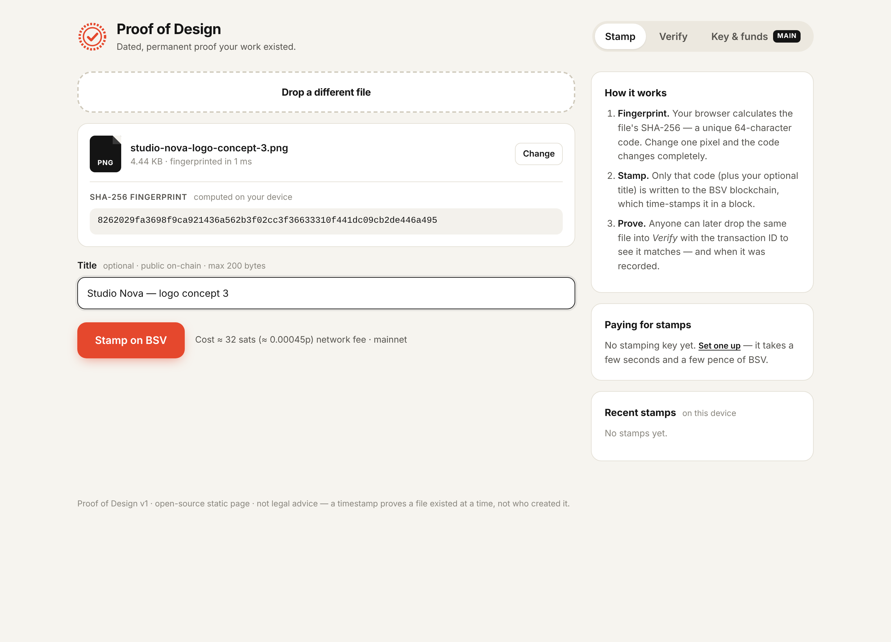

# Proof of Design — v1

Timestamp your design files on the BSV blockchain. Drop in a file, the browser works out its
**SHA-256 fingerprint on your own device** (the file is never uploaded), and that fingerprint is
written into a BSV transaction. The transaction's block time is permanent, public, dated proof
that this exact file existed at that moment. You get a printable certificate, and anyone can
check it later in the **Verify** tab.



## 1. Open it or host it

It's a plain static site with no build step and no server code.

- **Quickest way:** double-click `index.html`. It works straight from disk in Chrome, Edge,
  Firefox or Safari.
- **Recommended for real use: host it on HTTPS for free.** Opening from disk is fine for trying
  it out, but browsers share one storage area across *all* local files, so a hosted copy keeps
  your stamping key better isolated. To put it on GitHub Pages:
  1. Create a new public GitHub repository, e.g. `proof-of-design`.
  2. Upload everything in this folder. The `tests/` folder is optional.
  3. Go to Settings → Pages → Source: *Deploy from a branch* → `main` / root → Save.
  4. Your tool will be live at `https://<your-username>.github.io/proof-of-design/`.
  Netlify Drop (drag the folder onto app.netlify.com/drop) or Cloudflare Pages also work.

## 2. Fund the stamping key

Every stamp is a tiny BSV transaction, so something has to pay the network fee. v1 gives you
two ways to do that:

**A. Built-in stamping key (default, tested)**
1. Open **Key & funds**, then click **Create stamping key**. A new key is generated in your
   browser and kept in its local storage. It never leaves the page.
2. Click **Download backup** and store the `.txt` file somewhere safe. If you clear your
   browser data without a backup, the key is gone, along with any BSV on it.
3. From any BSV wallet (HandCash, Yours, RockWallet, ElectrumSV…), send a **small** amount to
   the address or QR code shown. **100,000 satoshis (0.001 BSV, about 1.4p)** pays for about
   3,000 stamps. Don't put your savings on it; treat it like a coin jar.
4. Click **Refresh balance**, then go back to **Stamp**.
5. **Withdraw all to my wallet** sends everything back to an address of your choice whenever
   you like.

The page never asks for your main wallet's seed phrase. If you paste something that looks like a
12/24-word seed into the import box, it refuses it.

**B. Your own BRC-100 wallet (beta, untested with a real wallet)**
If a BRC-100 wallet such as BSV Desktop / Metanet Desktop is running on the same computer,
**Connect BRC-100 wallet** hands each stamp to that wallet to approve, pay and sign. Your
wallet's keys never touch the page. This uses `WalletClient` from the official `@bsv/sdk`.

**Testnet:** switch to *Testnet* in **Key & funds** to practise for free. It uses a separate key.
Fund it from a testnet faucet such as https://bsvfaucet.com or https://witnessonchain.com/faucet/tbsv,
and tick "testnet transaction" when verifying.

## 3. What a stamp costs

| | |
|---|---|
| Typical stamp transaction | ~285–310 bytes (1 input, OP_RETURN output, change) |
| Network fee rate | **100 sat per 1,000 bytes**, GorillaPool ARC live policy (`arc.gorillapool.io/v1/policy`, checked 8 Oct 2026). The page reads this live each time. |
| **Fee per stamp** | **≈ 29–32 satoshis** (measured: 285 B → 29 sats, 308 B → 31 sats) |
| BSV price | **£13.91 / $18.40 per BSV**: CoinGecko simple-price API, 8 Oct 2026 ~19:55 BST (WhatsOnChain showed $18.42) |
| **In pounds** | 31 sats × £13.91 / 100,000,000 ≈ **£0.0000043 (0.00043p) per stamp**. That's about 2,300 stamps per penny. |

The OP_RETURN output itself carries 0 satoshis. The only cost is the miner fee. If you switch on
a service fee (below), that amount is added on top.

## 4. What goes on-chain

One unspendable output: `OP_FALSE OP_RETURN "PROOFOFDESIGN" "1" <32-byte SHA-256> "<title>" "<ISO time>"`.
The file name is **not** put on-chain. The title is optional and **public forever**. The block
time is the authoritative timestamp. The ISO time inside the record is just the stamping device's
clock.

Anyone can check a stamp without this tool. Run `shasum -a 256 file` (macOS/Linux) or
`certutil -hashfile file SHA256` (Windows), then compare the result with the 32-byte value in the
transaction on any BSV explorer.

## 5. Selling it: next steps

1. **Charge a micro-fee per stamp.** In `js/config.js`, set
   `serviceFee: { address: '1YourOwnBSVAddress…', satoshis: 1000 }`. Each stamp then pays you
   1,000 sats (~£0.00014). Pick any amount; even 10,000 sats is only ~0.14p to a customer.
   Payments go straight from the customer's stamping key to your address, with no middleman.
2. **Host it on your own domain** (e.g. `proofofdesign.co.uk`) via GitHub Pages + a custom
   domain. A branded URL makes certificates look more credible.
3. **Paid tiers** that build on this v1:
   - *Batch stamping*: drop a whole project folder and put one Merkle root in a single
     transaction. Thousands of files would cost the same ~30 sats.
   - *Branded certificates*: studio logo and client name, PDF export.
   - *Client hand-off pack*: a certificate and verification link for every deliverable, sold
     per project.
   - *Subscription for studios*: a server-side stamping wallet, so customers don't need any BSV
     and you bill them monthly in GBP.
4. **Prove it with your own work.** Stamp your portfolio publicly and log the results, like the
   "proof of skill" dashboard idea. That becomes your marketing.
5. Get a short **legal review** of the wording before you sell "proof" to clients (see the
   limitations below).

## 6. Limitations and risks (please read)

- **A timestamp proves existence, not authorship.** It shows *this exact file* existed at block
  time. It doesn't prove you made it. Keep drafts, source files and emails too.
- **Byte-exact.** Re-exporting, re-saving, compressing or stripping metadata changes the
  fingerprint. Stamp the master file you'll keep, and keep it unchanged.
- **The stamping key is a hot key in a browser.** Clearing site data, a different browser or a
  new computer means it's gone unless you have the backup. A malicious browser extension or a
  compromised copy of the page could steal it. Keep the balance small (the page warns above
  1,000,000 sats).
- **Third-party services.** Balances and verification use the free WhatsOnChain API (rate-limited
  to a few requests per second). Broadcasting uses GorillaPool ARC, with WhatsOnChain as a
  fallback. If both are down, stamping fails safely and nothing is spent.
- **Big files.** Files are read into memory to hash them. Files up to a few hundred MB are fine.
  Multi-GB files may fail on low-memory devices.
- **Unconfirmed at first.** Right after stamping, the transaction is in the mempool. Its block
  time appears about 10 minutes later. Download the certificate again from **Verify** at that
  point to get the block time printed on it.
- **BRC-100 wallet mode hasn't been tested against a real wallet yet.** Use the stamping key until
  it has been.
- **Not financial or legal advice.**

## 7. Developer notes

```
index.html, styles.css
js/config.js        settings (network, service fee, endpoints)
js/core.js          hashing format, OP_RETURN build/parse, tx building (shared with tests)
js/certificate.js   printable HTML certificate
js/app.js           UI + WhatsOnChain/ARC/WalletClient glue
vendor/             @bsv/sdk 3.2.0 subset (IIFE) + qrcode-generator
tests/core.test.js     node tests/core.test.js        (offline tx tests + one live read-only WOC fetch)
tests/browser.test.js  headless Chrome end-to-end (needs `npm i playwright-core`, Chrome, and `python3 -m http.server 8765` in this folder); all broadcasts are mocked, nothing is sent
```
